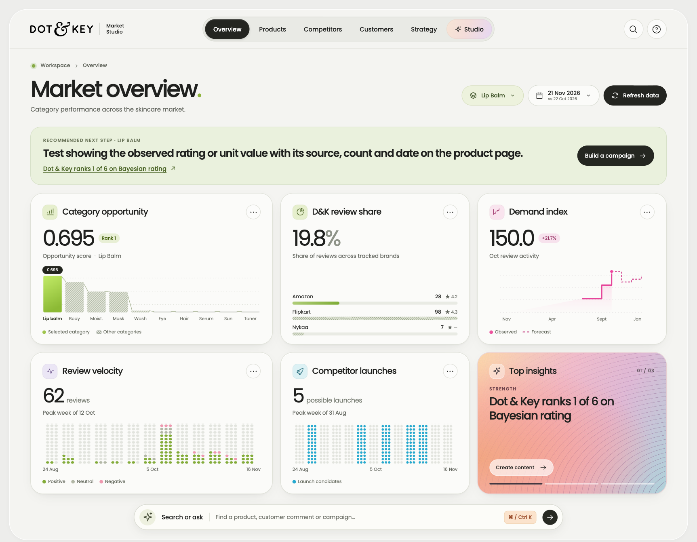
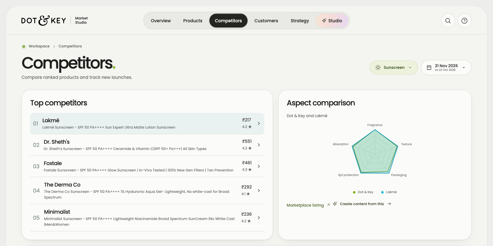
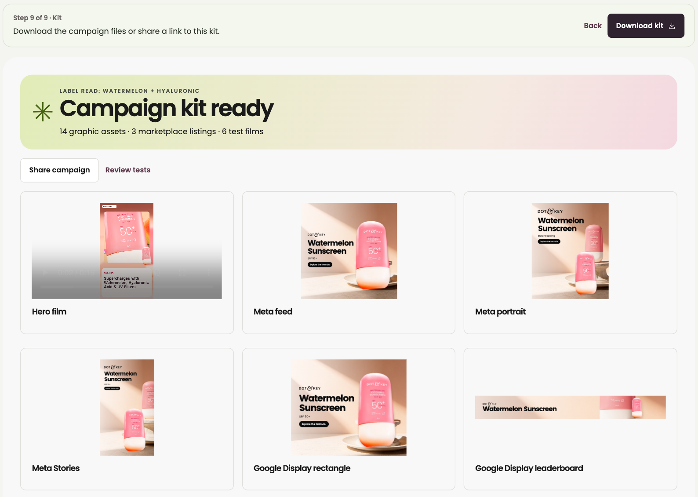
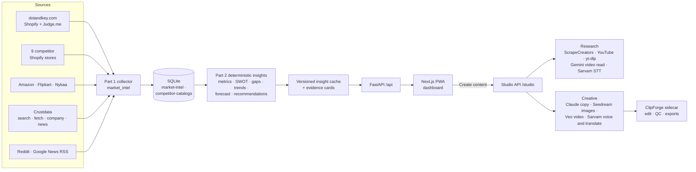

# Dot & Key Market Studio

Market intelligence to marketing content in one app. Market Studio monitors Dot & Key and its top competitors across Shopify storefronts, Amazon India, Flipkart and Nykaa. It reads the reviews and turns them into evidence-backed SWOT findings, market gaps, launch alerts, demand forecasts and go-to-market actions. It then carries any insight into a Studio that researches winning reels, writes the script and produces checked ads, A+ content, listings and video.

Built for the Vibe Coders Hackathon Ed. 3 brief ([problem-statement.pdf](problem-statement.pdf)).

- **Everything is open.** No login, access code or payment step. Judges can use every feature.
- **Every number has a source.** Insights come from rules over scraped observations, not from a chatbot. Each card and answer links to the review, listing or catalog entry behind it.
- **Installable.** It is a PWA that works on phone and desktop, keeps visited reports available offline, and starts with a guided tour.



In the 21 November 2026 report, Lip Balm ranked first for opportunity. Dot & Key accounted for 19.8% of the reviews counted across the six tracked brands.

---

## Quick start

```sh
docker compose up --build        # web, API and ClipForge
open http://localhost:3000
```

The included data (crawled 21 Nov 2026) and the **Watermelon Sunscreen** demo campaign work without any API keys. To run new crawls, research or generation, copy `.env.example` to `.env` and add the keys in [Keys and services](docs/keys-and-services.md). Then run `docker compose up -d` again.

To run without Docker:

```sh
python3 -m venv .venv && .venv/bin/pip install -r requirements.txt
.venv/bin/uvicorn market_intel.api:app --port 8000            # API
npm --prefix studio-web ci && npm --prefix studio-web run dev # web on :3000
```

Deployment to Railway is one command: `.venv/bin/python deploy/railway.py`. See [deployment](docs/market-studio-deployment.md).

---

## Using the app

### The six screens
| Screen | What you see | Use it to |
|---|---|---|
| **Overview** | Category opportunity bars, D&K review share, demand index with forecast, review velocity, competitor launches, top insights carousel | Decide where to focus. Click a bar to switch category. |
| **Products** | D&K catalog. Open a product to see its marketplace listings, observed prices, ratings and reviews. | Check how one SKU performs on each marketplace |
| **Competitors** | Top 5 competitors per category, an aspect comparison radar (D&K against peers), competitor launches, brand momentum (traffic, hiring, followers) | See who is gaining and what they just launched |
| **Customers** | Customer sentiment per aspect (white cast, greasy, irritation…), customer requests, quotes "in customers' words" | Hear what buyers love and complain about |
| **Strategy** | SWOT, market gaps (whitespace), trend signals, demand forecast, go-to-market recommendations | Get the actions, each traced to its trigger |
| **Studio ✦** | Six steps: Research → Deconstruct → Patterns → Concepts → Create → Test | Turn an insight into a tested campaign kit |

Pick the **category** and the **reporting date** at the top. Use "compared to" to see change over time.



Select a competitor to compare its price and rating, then see how customers describe its fragrance, texture, packaging, sun protection and absorption alongside Dot & Key.

### Search or ask: ⌘K / Ctrl+K
One box does both.

- **Jump:** type a product, category, campaign or view, then press Enter, or type `/` to jump straight away.
  - `/lip balm`, `/sunscreen`
  - `/competitors`, `/swot`
  - `/product watermelon`
  - `/campaign kit`, `/video production`
- **Ask:** type a question (starting with *what, who, how, which…* or ending in `?`) and press Enter. The answer quotes up to three evidence cards. Click a numbered source to open the card behind it. Questions that work well:
  - `What do customers complain about?`
  - `What are the biggest gaps?`
  - `Who launched new sunscreens recently?`
  - `What are the threats?` / `What are our weaknesses?` / `What are our strengths?`
  - `Who scores higher at a lower price?`
  - `What is our review share?`
  - `How does demand look for the next 3 months?` (only for categories with a forecast)
  - `Why is lip balm our biggest opportunity?`
  - `What should we do next quarter?`

When the evidence doesn't support an answer, Ask says so instead of guessing.

### From insight to campaign
1. On any gap, threat or recommendation card, click **Create content from this**. The Studio opens a campaign brief with that evidence attached.
2. **Research:** browse the swipe file of competitor and creator posts, ranked by outlier ratio (views ÷ the account's median). Or paste any Reel, Short or post URL, or upload a video.
3. **Deconstruct:** step through the frames, cuts, on-screen text, transcript, hook timing and beats. Click any finding to jump to that moment in the video.
4. **Patterns → Concepts:** choose a winning pattern (for example "show the demonstration early"), then pick one of three creative concepts.
5. **Create:**
   - Statics: Meta, Amazon, Flipkart, Nykaa and display sizes
   - A+ content modules
   - Marketplace listings, with Hindi or Hinglish via **Localize**
   - Script and storyboard
   - Video: drafts, then a hero film exported for Reels, Shorts and Meta
6. **Test:** check the QC gate (claim guard, technical QC, brand review), the variant matrix and the test plan. Then **download the campaign kit**.



The saved Watermelon Sunscreen kit brings together 14 graphic assets, three marketplace listings and six test films. Use **Share campaign** to send a link or **Download kit** to get the files.

### Live demo
A rehearsed 8-minute script with the exact commands and questions is in **[docs/demo-script.md](docs/demo-script.md)**.

### Walkthrough and install
On the first visit, a welcome sheet and a 7-step spotlight tour appear. Reopen them any time from **Help** (?). On a phone, use the browser's **Install** / **Add to Home Screen** to install the app.

---

## How it works



1. **Collect (Part 1).** Shopify `products.json` gives the full catalogs of D&K and 9 competitors at no cost. Judge.me gives D&K's own reviews. Crustdata finds and fetches the marketplace listings and their reviews, then adds competitor company signals and news. Every observation is timestamped in SQLite, so prices and ratings build up a history.
2. **Analyse (Part 2): no AI needed.**
   - A frozen aspect lexicon tags review sentences. Its precision is validated in [validation/](validation/README.md).
   - Bayesian ratings, Wilson intervals and complaint lift give the metrics.
   - A rule table turns the metrics into SWOT findings.
   - Attribute whitespace finds the gaps, and cross-source term growth finds the trends.
   - Day-over-day Shopify diffs detect launches.
   - A monthly projection gives the forecast, and recommendation templates are each linked to the finding that triggered them.

   The same input always gives the same output.
3. **Serve.** Reports are built once per category and date, cached atomically, and split into small dashboard payloads and stable **evidence cards**. Ask and Search rank those cards. A small model may only *choose card IDs*, so no model-written claim reaches the screen.
4. **Create (Parts 3 and 4).**
   - The Studio stores each campaign as an inspectable folder of JSON and media.
   - Research uses real posts and their measured outlier ratios.
   - Copy is claim-guarded against the catalog wording.
   - Ads are rendered from HTML templates around a cut-out of the real packshot.
   - Video is edited in the unmodified ClipForge sidecar, connected to our providers through a small compatibility shim.

The full under-the-hood walkthrough covers modules, data flow, models, jobs, caching, the PWA and the deployment topology. It is in **[docs/architecture.md](docs/architecture.md)**.

---

## Documentation

| Doc | Read it for |
|---|---|
| [docs/architecture.md](docs/architecture.md) | How everything works under the hood |
| [docs/demo-script.md](docs/demo-script.md) | Live demo: commands and questions to use in front of the client |
| [docs/keys-and-services.md](docs/keys-and-services.md) | Every external service and model, what it is used for, and the env vars |
| [docs/market-intelligence.md](docs/market-intelligence.md) | Part 1 and 2 CLI: crawling, insight exports, competitor selection, the included dataset |
| [docs/content-studio.md](docs/content-studio.md) | Studio setup, the included campaign and creating new campaigns |
| [docs/market-studio-deployment.md](docs/market-studio-deployment.md) | Docker Compose, Railway deployment and CI checks |
| [docs/local-minilm.md](docs/local-minilm.md) | Optional local embedding model for customer-request clustering |
| [validation/README.md](validation/README.md) | Aspect tagger precision evaluation |
| `docs/plan-part1…4-*.md` | The original design plans (historical; architecture.md describes what was built) |

## Repository map

```
market_intel/            Python backend (FastAPI + CLI: python -m market_intel)
  catalog.py …           Part 1 collection: Shopify, marketplaces, reviews, competitors, Crustdata client
  metrics.py swot.py …   Part 2 deterministic insights
  frontend_api/          /api for the dashboard: overview, products, search, ask, refresh jobs
  studio/                /studio API: campaign runs, jobs, throttle, kit export
  studio_research/       post discovery, paste-link resolution, frame/OCR/transcript analysis, patterns
  studio_creative/       brief, concepts, scripts, ads, A+, listings, localization
  studio_film/           film rendering, ClipForge sidecar client, provider shim
studio-web/              Next.js 16 PWA (dashboard + Studio)
clipforge/               how to run the pinned upstream ClipForge
vendor/creator-breakout-kit/   pinned upstream research skills (MIT)
lexicons/aspects.yaml    the aspect dictionary used for sentiment
data/                    SQLite databases, insight exports, demo campaign
deploy/                  Railway deploy, API start-up seeding, nightly job, smoke and Lighthouse checks
tests/ validation/       pytest suite and aspect-precision evaluation
```

## Verify

```sh
.venv/bin/pip install pytest && .venv/bin/python -m pytest -q
npm --prefix studio-web run build
```
