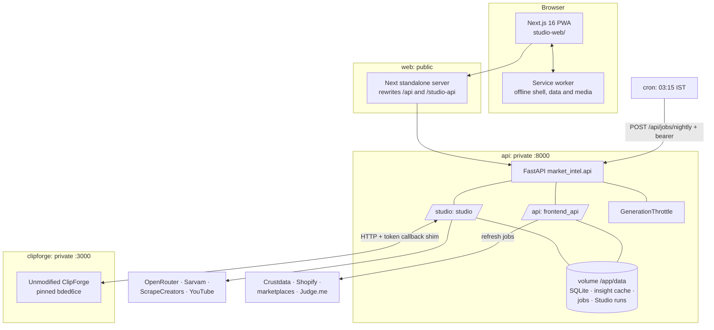

# Architecture: How Market Studio Works

This page follows a single path, from a competitor's storefront to a finished ad film. For each layer it covers what runs, where the code lives, what is stored and which external service (if any) is involved. Commands and flags are in the per-part docs linked at the end.

**Design rules that run through the whole system:**
1. **Observed, not generated.** Every number and claim on screen comes from a stored observation: a review, listing, catalog entry or measured video frame. Models are used to *extract*, *select* or *write copy from locked facts*, never to state market facts.
2. **Deterministic analysis.** SWOT, gaps, trends, launches, forecast and recommendations are rules and statistics over SQLite. They cost no AI credits and are reproducible.
3. **Everything is inspectable.** Reports, evidence cards and Studio runs are plain JSON on disk with stable IDs, and every claim links to its source.
4. **Fully open demo.** There is no login, access code or payment step. Spend is held back only by invisible limits (§8).

---

## 1. System overview

| Process | Code | Runs as |
|---|---|---|
| Web app | `studio-web/` (Next.js 16, React 19) | `studio-web/Dockerfile`, standalone output |
| API | `market_intel/api.py`, which mounts `frontend_api/router.py` (`/api`) and `studio/api.py` (`/studio`) | `Dockerfile.api` → `deploy/start_api.py` |
| ClipForge | upstream `xixihhhh/clipforge` at a pinned commit | built straight from GitHub (`compose.yaml`) |
| Nightly job | `deploy/Dockerfile.cron` → `deploy/nightly.sh` | Railway cron service |
| CLI | `python -m market_intel …` (`market_intel/__main__.py`) | for local crawls and exports |

The browser only ever talks to the **web** origin. Next's rewrites (`studio-web/next.config.mjs`) proxy an allow-list of `/api/*` sections and `/studio-api/*` to the private API (`STUDIO_BACKEND`). The nightly maintenance endpoint is deliberately excluded from that list.

---

## 2. Part 1: Collection

**Code:**
- `catalog.py`, `reviews.py`, `marketplaces.py`, `marketplace_parsers.py`, `nykaa.py`
- `competitors.py`, `crosschecks.py`, `catalog_history.py`
- `client.py` (transport)
- `store.py` (SQLite)

| Step | Source | How |
|---|---|---|
| D&K catalog | `dotandkey.com/products.json` (Shopify) | Paged JSON. `fltr_` tags give skin concerns and ingredients. Combos are linked to their singles, and free gifts are dropped. `attributes.py` derives category, format, SPF, size and price band. |
| D&K reviews | Judge.me public widget | Per product handle, deduplicated by body hash |
| Marketplace listings | Amazon.in, Flipkart, Nykaa | Discovered through marketplace search (direct, or Crustdata `/web/search/live`). Fetched directly or through Crustdata `/web/enrich/live` (`human_mode` for Nykaa). Parsed from JSON-LD and embedded state into price, MRP, rating, counts and reviews. Fuzzy-matched to the catalog on title, size and SPF, with an override CSV for edge cases. |
| Competitor selection | 2 search pages per category | Score = 35% log rating count + 25% search position + 20% price-band overlap + 20% ingredient or claim overlap, with at most one product per brand and the top 5 kept. Crustdata's `ai` search is attached as a cited cross-check. |
| Competitor catalogs | 9 competitor Shopify stores | A complete daily snapshot (`catalog_history.py`) in `competitor-catalogs.sqlite3`. New product IDs and `published_at` within 90 days count as **launch candidates**. Variant-level diffs give **price changes**. |
| Brand signals | Crustdata `/company/enrich` | Web traffic, followers, headcount, hiring, funding and news, used for the *Brand momentum* card |
| News and chatter | Crustdata news search, Google News RSS, indexed Reddit | Dated launch stories and customer discussions |
| Missing fields | OpenRouter `anthropic/claude-haiku-5.5` | Used only when a parser misses a field. The output is a fixed JSON schema, and the matching source excerpt is stored with it. |

`client.py` handles every outbound request:
- per-host rate limiting
- a 10 RPM token bucket for Crustdata
- 429 back-off
- a 24-hour disk cache (`data/cache`)
- a run deadline
- a `crawl_log` row for every response, including the credits Crustdata reports

Every listing observation is a timestamped `listing_snapshot`, so price and rating history accumulates.

**Store:** `data/market-intel.sqlite3` has tables `product`, `listing`, `listing_snapshot`, `review`, `competitor_set`, `brand_signal`, `news_item` and `crawl_log`.

---

## 3. Part 2: Deterministic insights

**Code:** `insights.py` orchestrates these modules for one category and one `as_of` date:

| Module | Output | Method |
|---|---|---|
| `aspects.py` + `lexicons/aspects.yaml` | Sentence-level aspect and polarity (white cast, greasy, irritation, hydration…) | A spaCy sentence splitter and a frozen lexicon with negation handling. Only aspects that pass the precision gate ([validation](../validation/README.md)) may support claims. |
| `metrics.py` | Ratings, aspect shares, complaint lift, unit prices, discounts | Bayesian rating (prior weight 50), Wilson intervals, net sentiment, and price per g or ml |
| `swot.py` | Up to 5 findings per quadrant | A rule table, for example `top_rating`, `channel_gap` (same SKU ≥0.3★ apart across markets), `better_value`, `recent_launch` and `whitespace`. Findings are ranked by effect size × log(n) and carry their thresholds and quotes. |
| `gaps.py` | Whitespace, category pain, customer requests | Attribute combinations with sparse supply but nearby review demand. Request phrases are clustered with local MiniLM ONNX, or with token overlap when it is unavailable ([local-minilm.md](local-minilm.md)). |
| `trends.py` | Rising terms | Term growth across **both** dated catalog creations and dated reviews. A term must rise in both sources to qualify. |
| `forecast.py` | 3-month demand index | A monthly projection of review activity for a fixed product cohort. It needs ≥6 months of coverage, the latest 3 months observed and ≥30 observations; otherwise it reports `insufficient_history` and the reason. |
| `recommendations.py` | Go-to-market actions | Templates keyed to finding types. Each action carries the `trigger_ids` of the findings that produced it. |

The **opportunity score** per category combines projected growth, D&K's review share and the number of distinct gaps. Its factors are exposed in `score_factors`.

---

## 4. Serving the dashboard (`market_intel/frontend_api/`)

| File | Role |
|---|---|
| `cache.py` | Builds each `(category, date)` report once and publishes it atomically as a versioned file under `data/cache/insights`. Writes are guarded by a lock, and up to 12 dates are kept per category. `warm()` runs at API start and after every refresh. |
| `market.py` | `GET /api/overview`: a compact payload with category bars, review share and its delta against the compare date, weekly review and launch velocity, demand series and top insights. The large evidence arrays stay in the detail endpoints. |
| `catalog.py` | `GET /api/products`, `/api/products/{handle}`, `/api/competitors`, `/api/launches` |
| `evidence.py` | Turns every report item into a **card** with a stable `id`, `type`, `title`, `description` and `href` (a deep link such as `/?view=strategy&category=Sunscreen&as_of=…#<id>`). Ask, Search, dashboard cards and Studio briefs all share these IDs. |
| `search.py` | `GET /api/search`: one index over evidence cards, catalog products, reviews and saved Studio campaigns. Ranking is lexical with IDF weighting, scoped to the category named in the query or otherwise the current one. |
| `ask.py` | `POST /api/ask`, streamed over SSE (described below) |
| `jobs.py` | `POST /api/refresh?category=` and the private `POST /api/jobs/nightly` (described below) |
| `router.py` | Wires the routes, plus `/api/health` and `/api/version` |

### How Ask answers a question
1. `search.retrieve()` ranks evidence cards for the question. It can span categories, for example "compare sunscreen and lip balm".
2. If `OPENROUTER_API_KEY` is set, the top candidates (titles and descriptions only) go to a small model (`MARKET_ASK_MODEL`, default `openai/gpt-4o-mini`). The model returns **up to 3 card IDs**, or none if the evidence is insufficient. Its prompt treats the question and the evidence as data.
3. The server streams the **stored titles and descriptions** of the chosen cards as the answer, followed by their citations. No text the model writes is shown. Without a key, or on a model error, the lexical top 3 are used.
4. With no supporting evidence, it says so rather than guessing.

In the browser, the ⌘K sheet (`studio-web/app/market-command.jsx`) works as follows:
- It treats input as a **question** if it starts with *what/why/how/who/which/…* or ends in `?`. Otherwise it is a **jump** to the top search result.
- `/` forces a jump.
- Clicking a citation deep-links to the exact card.

### Refresh and nightly jobs
- `jobs.submit()` is single-flight: one collection at a time, guarded by a file lock. Calling it again with the same job returns the running job, and a different one gets HTTP 409.
- A job's status is a JSON file updated at every stage. `GET /api/jobs/{id}/events` streams it as SSE, so the **Refresh data** button shows live stage names.
- **Refresh** re-crawls one category end to end with `refresh=True`, then re-warms the cache.
- **Nightly** (cron, bearer `JOBS_CRON_TOKEN`) snapshots all competitor storefronts and Amazon search pages, warms the cache and prunes unpinned Studio runs older than 14 days.
- `MARKET_COLLECTION_TIMEOUT_SECONDS` (default 2 h) caps a run. Data already collected is kept.

---

## 5. Studio: research → content (`market_intel/studio*`)

A **campaign run** is a folder under `STUDIO_RUNS_DIR` (default `data/studio/runs/<id>/`). It holds `run.json`, `brief.json`, `research/`, `patterns.json`, `concepts.json`, `script.json`, `creative.json`, `variants.json`, `locales/`, `assets/`, `film/` and `recipes/`. All paths inside it are relative, so a run can be copied or zipped (`GET /studio/runs/{id}/kit.zip`).

Long operations return a job ID straight away (HTTP 202). They run on a 3-worker pool, mutations are serialized per run, and progress streams over the same SSE mechanism. `watermelon-demo` is the pre-built demo run, and it is never pruned.

| Step (UI) | Endpoint | What happens |
|---|---|---|
| **Brief** | `POST /studio/runs`, `/brief` | `studio_creative/brief.py` builds a fact sheet from the catalog (approved wording, claims, SPF, ingredients, images) and attaches the market evidence card the user started from. Catalog facts and research findings are kept apart. |
| **Research** | `/discover`, `/uploads` | `studio_research/sources.py` pulls competitor and creator accounts. Instagram and TikTok come from ScrapeCreators, YouTube from the Data API v3, and Crustdata social search adds more. Each post is scored by **outlier ratio = views ÷ the account's median views**, using the Creator Breakout Kit method (`vendor/creator-breakout-kit`). |
| **Paste a link** | `/deconstruct` | `studio_research/analysis.py` resolves any public Instagram, YouTube or TikTok URL, or an uploaded MP4 or image carousel. When a platform blocks the download, you can attach the media yourself. |
| **Deconstruct** | (same job) | `studio_research/media.py`: • ffmpeg normalization • shot boundaries • timestamped frames • Tesseract OCR (English and Hindi) for on-screen text • OpenCV pack and face presence • transcript via **Sarvam Saaras v3**, with local faster-whisper as fallback • a semantic read by **Gemini 2.5 Flash** on OpenRouter (`STUDIO_VISION_MODEL`), giving hook, beats and portable "bricks" with timestamp citations |
| **Patterns** | (derived) | `studio_research/patterns.py` groups inspected posts into formats ("Show the demonstration early") with a winning spec: hook ≤1.5 s, product by 3 s, text by 1 s, length band. A direction backed by one source is labelled a hypothesis. |
| **Concepts** | `/concepts` | `studio_creative/copy.py` asks **Claude Sonnet 5.5** (`STUDIO_COPY_MODEL`) for three directions grounded in the brief and the patterns |
| **Script & storyboard** | `/generate` | `copy.py` writes shot-by-shot scripts timed to the chosen reference's rhythm. `claim_guard` rejects any line that departs from catalog wording or SPF. |
| **Statics & A+** | `/generate` | `studio_creative/assets.py`: • cuts out the real PDP packshot with **rembg U2NetP** • gets backgrounds from **Seedream 4.5** (`STUDIO_IMAGE_MODEL`) • renders HTML templates in headless Chromium at Meta, Amazon, Flipkart, Nykaa and display sizes, plus 5 A+ modules • checks the colours against D&K swatches |
| **Listings** | `/generate` | `studio_creative/commerce.py` writes catalog-locked titles, bullets and descriptions for Amazon, Flipkart and Nykaa, plus the test plan |
| **Localize** | `/localize` | `studio_creative/localize.py` translates forward with **Sarvam Mayura v1** and back with **Sarvam-Translate v1**. It flags changed numbers, banned claims and reversed claim direction, and every line needs bilingual sign-off. |
| **Video** | `/film`, `GET /film-quote` | `studio_film/` renders draft variants from real catalog images and free speech (Edge TTS, with espeak as fallback). **Generate hero film** quotes the live **Veo 3.1 Lite** price from OpenRouter, shows it on the button, and records it in the recipe. Final narration uses **Sarvam Bulbul v3**. Editing, QC, cover and carousel happen in ClipForge (§6). Exports: Reels and Shorts at 1080×1920, Meta at 1080×1350. |
| **Test** | `/readback` | `studio/measurement.py` measures each export against its reference spec (hook time, cut pace, text density). A gate combines claim guard, technical QC and ClipForge's review into pass, warn or fail. A published post can be attached later with real impressions and clicks. A rate with no denominator is shown as unavailable rather than invented. |

Every model call goes through small cached transports (`studio_creative/provider.py`, `studio_film/providers.py`). Their prompts, model, cost and outputs are written to `recipes/`, so each asset can be traced.

---

## 6. ClipForge integration

ClipForge runs **unmodified** as a private sidecar. `studio_film/sidecar.py` drives its HTTP API (the same API its MCP tools use): project import, script import, contact sheet, QC, gate, cover, carousel and platform export. ClipForge's script judge runs on OpenRouter (`google/gemini-2.5-flash-lite`, set by `STUDIO_JUDGE_MODEL`).

ClipForge only speaks "OpenAI-compatible" for media, so `studio_film/shim.py` provides those endpoints and translates them:

| ClipForge calls | Shim forwards to |
|---|---|
| `/v1/audio/speech` | Sarvam Bulbul TTS |
| `/v1/images/generations`, `/v1/images/edits` | OpenRouter images (Seedream 4.5) |
| `/v1/videos`, `/v1/videos/{id}`, `/v1/videos/{id}/content` | OpenRouter videos (submit, poll, download) |

Each media operation needs a bearer `STUDIO_SHIM_TOKEN`. The API opens the callback only for that operation (`STUDIO_GRID_BIND_HOST` / `STUDIO_GRID_CALLBACK_HOST`).

---

## 7. Frontend (`studio-web/`)

| File | Role |
|---|---|
| `app/page.jsx`, `layout.jsx` | Server-rendered first page (including the welcome sheet) to keep hydration small |
| `market-app.jsx` | Shell: sidebar (desktop) or bottom tab bar (<768 px), category and date pickers, routing via URL params (`?view=&category=&as_of=&compare=#card`), the Refresh button with SSE progress |
| `market-charts.jsx` | Overview widgets as custom SVG: hatched opportunity bars, review share, demand step line with dashed forecast, dot-matrix review and launch velocity, insights carousel |
| `market-details.jsx` | Products, Competitors (radar, launches, momentum), Customers (sentiment, requests, quotes), Strategy (SWOT, gaps, trends, forecast, GTM). Every card has **Create content from this**. |
| `market-command.jsx` | The ⌘K "Search or ask" sheet |
| `studio*.jsx`, `research.jsx`, `production.jsx`, `campaign-brief.jsx`, `product-picker.jsx` | Studio stepper and the six steps |
| `experience.jsx`, `tour-driver.js` | Welcome sheet, the 7-step driver.js tour, coach marks on first visit, offline banner, install prompt |
| `manifest.js`, `public/sw.js` | PWA manifest and a hand-written service worker |

**Design:**
- D&K brand tokens: Poppins; green `#82B51C`, pink `#FF40B1`, orange `#FF803A`, cyan `#22BCE0`, ink `#1A1A1A`
- the layout follows the referenced dashboard shots
- motion uses `motion`
- each UX law is mapped to a concrete rule in [plan-part4](plan-part4-frontend-and-deploy.md) §5

**Offline:**
- The service worker pre-caches the app shell on install.
- It serves `/api` reads stale-while-revalidate from a bounded data cache.
- It caches product and thumbnail images (Shopify CDN, YouTube thumbnails) and campaign media in a media cache.
- A version bump retires old caches.
- Write actions check `navigator.onLine` first and explain when offline.

---

## 8. Open access and spend limits

There is no authentication. Paid generation is held back by limits the user never sees:
- **Per-IP throttle** (`studio/throttle.py`). This ASGI middleware applies 60 POSTs per hour per client to `/api/ask`, `/api/refresh`, `/studio/runs` and every Studio operation. Above that it returns HTTP 429 with `Retry-After`. Counts live in `data/studio/rate-limits.sqlite3`, and the client IP comes from Railway's `X-Real-IP` when `STUDIO_TRUST_PROXY=1`.
- **OpenRouter key cap.** `deploy/railway.py` checks with OpenRouter that the key has a credit limit before it enables public paid generation. Without a cap, the deterministic tools and the demo still work.
- **Single-flight market jobs**, a deadline on collection runs, and generation receipts that let a known paid video job resume instead of being paid for again.

---

## 9. Deployment

`docker compose up --build` runs the same three containers locally. On Railway, `deploy/railway.py` creates the project `dotandkey-market-studio` with 4 services:

| Service | Exposure | Notes |
|---|---|---|
| web | public `*.up.railway.app` (HTTPS, which the PWA needs) | Next standalone, `STUDIO_BACKEND=http://api.railway.internal:8000` |
| api | private | Volume at `/app/data`. On first boot `start_api.py` **seeds** the volume from `/app/seed-data` (databases and the demo run), because a fresh volume would otherwise hide the data baked into the image. A restart resumes a partial copy. It then warms the cache and serves on `::` dual-stack for Railway private networking. |
| clipforge | private | Volume at `/data`, `HOSTNAME=::` |
| cron | scheduled `45 21 * * *` UTC (03:15 IST) | `POST /api/jobs/nightly` with a bearer token |

Provider keys go to the API through stdin, never through the repo. CI (GitHub Actions) does the following:
- runs Ruff and pytest
- starts the stack
- runs Playwright smoke tests at 390×844 and 1440×900
- checks the PWA manifest, service worker and offline navigation
- requires Lighthouse performance and accessibility ≥90 (median of 3 runs)

Details are in [market-studio-deployment.md](market-studio-deployment.md).

---

## 10. Models and services at a glance

| Purpose | Provider / model | Env override |
|---|---|---|
| Fallback field extraction (Part 1) | OpenRouter `anthropic/claude-haiku-5.5` | `OPENROUTER_MODEL` (Anthropic direct via `ANTHROPIC_MODEL` if no OpenRouter key) |
| Ask evidence selection (IDs only) | OpenRouter `openai/gpt-4o-mini` | `MARKET_ASK_MODEL` |
| Concepts, scripts, listings | OpenRouter `anthropic/claude-sonnet-5.5` | `STUDIO_COPY_MODEL` |
| Video and post understanding | OpenRouter `google/gemini-2.5-flash` | `STUDIO_VISION_MODEL` |
| Backgrounds and images | OpenRouter `bytedance-seed/seedream-4.5` | `STUDIO_IMAGE_MODEL` |
| Hero film motion | OpenRouter `google/veo-3.1-lite` | n/a |
| ClipForge's own LLM | OpenRouter `google/gemini-2.5-flash-lite` | n/a |
| Narration | Sarvam `bulbul:v3` | n/a |
| Transcription | Sarvam `saaras:v3`, local faster-whisper as fallback | `STUDIO_WHISPER_MODEL` |
| Translation | Sarvam `mayura:v1` forward, `sarvam-translate:v1` reverse | n/a |
| Market data | Crustdata web search and fetch, company enrich, news | n/a |
| Social posts | ScrapeCreators (Instagram, TikTok), YouTube Data API v3 | n/a |
| Local, free | spaCy, MiniLM ONNX, rembg, OpenCV, Tesseract, ffmpeg, Chromium (Playwright), Edge TTS, espeak | n/a |

The full list of keys and environment variables is in [keys-and-services.md](keys-and-services.md).

## Where to go next
- [market-intelligence.md](market-intelligence.md): Part 1 and 2 CLI, the dataset and competitor selection
- [content-studio.md](content-studio.md): the Studio walkthrough and creating campaigns
- [market-studio-deployment.md](market-studio-deployment.md): Compose, Railway and CI
- [demo-script.md](demo-script.md): the live demo
